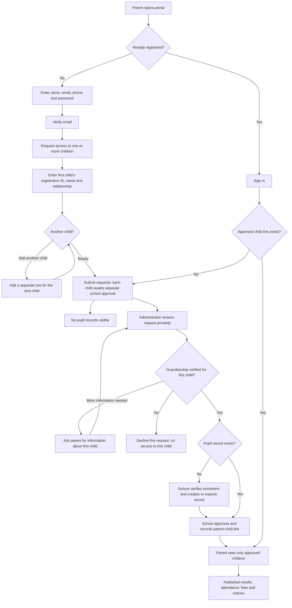

> Historical proposal, superseded by PARENT-ACCOUNT-LINKING.md. Parent accounts now register directly; private school-issued linking codes replace repeated staff approval.

# Proposed parent registration and approval

This is a proposed workflow, not an implemented feature.

Knowing a child's name or admission number is not proof of guardianship. Staff verify the relationship using trusted school records or an established contact. Each additional child requires a separately approved link. Every approval, decline and link change should record the responsible staff member and time.

## Multiple children in one parent account

The request form starts with one child row containing registration/admission ID, child's name, class if known, and the parent's relationship. An **Add another child** button adds another row; **Remove** removes an unsent row. Parents can submit several child requests together or request another child later without creating a new parent account. If an ID is unknown, they can submit details for private school review.

Each child has an independent status: pending, more information needed, approved or declined. Approving one child never approves the others. A parent can use an approved child's portal while other requests remain pending. Pending rows show only the details supplied by that parent; entering an ID must not reveal matching pupil data or confirm whether a pupil exists. Prevent duplicate active requests for the same child ID within the same account.

After approval, the existing child selector lists only approved, eligible children. An **Add another child** action remains available beside a separate **Access requests** section. Staff review and record a separate decision for each child.

Teachers use administrator-issued invitations with assigned roles and classes. Parents cannot select staff privileges. Google or Microsoft sign-in can simplify account authentication later; neither replaces guardian approval.
